# Stokes: an OpenFOAM GUI for Windows and Linux

**Stokes is a desktop CFD workbench and graphical interface for OpenFOAM®
Foundation 14.** Import a STEP file, click faces to make them inlets, outlets,
walls or symmetry planes, mesh with snappyHexMesh or cfMesh, run the solver and
look at slices, streamlines and iso-surfaces, in one window. Every action is
also an API call, so scripts and LLM agents can drive a simulation the same way
you do.

It is for engineers and students who want to use OpenFOAM without hand-editing
dictionaries, and for people who want to automate CFD. It runs natively on
**Windows** (through the [FoamWin](https://github.com/dhanninacs/foamWin) build of
OpenFOAM 14, no WSL needed) and on **Linux** (the official OpenFOAM 14 packages).

Docs site: **<https://dhanninacs.github.io/stokes-cfd/>** ·
Quick start: [Windows](docs/INSTALL-WINDOWS.md), [Linux](docs/INSTALL-LINUX.md) ·
[FAQ](#faq)

[](https://buymeacoffee.com/csdhan)

Stokes is built and maintained by one person. If it saves you time,
**[buy me a coffee](https://buymeacoffee.com/csdhan)**. It pays for the build
machines and the signing certificate that the first installer needs.

> OPENFOAM® is a registered trade mark of OpenCFD Limited, producer and
> distributor of the OpenFOAM software via www.openfoam.com. This product is
> not approved or endorsed by OpenCFD Limited.

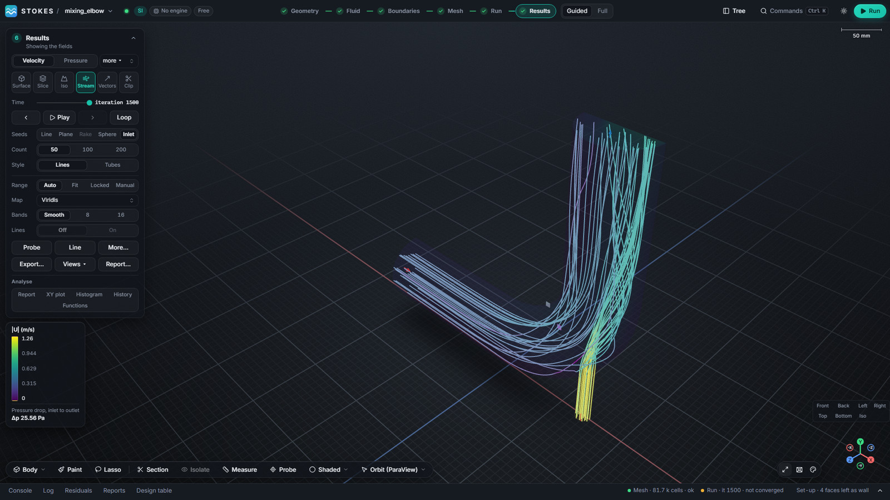

## Watch it

**[docs/video/elbow-walkthrough.webm](docs/video/elbow-walkthrough.webm)** (about
1½ minutes, no sound): a new project, the STEP import, fluid, boundaries, mesh,
a real OpenFOAM run, then velocity, temperature and streamlines, all driven
through the window. The waits are sped up. GitHub plays it in the browser; it is
also attached to the releases.

## What it looks like

One case, start to finish: a two-inlet mixing elbow (cold water at 0.4 m/s, hot
water at 1.2 m/s, symmetric half model, energy equation on, k-ε turbulence).
Every picture below is the app, not a mock-up.

| | |
|---|---|
| 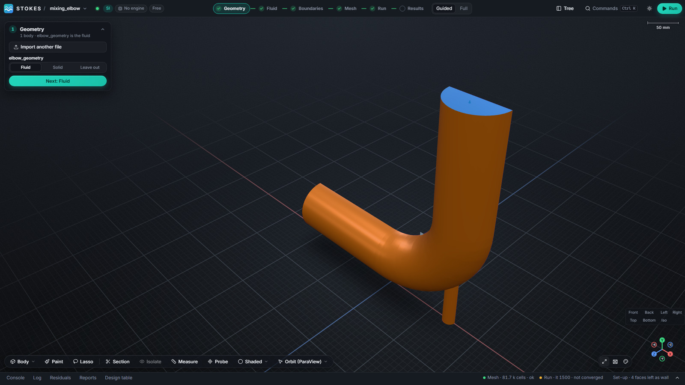 **1. Geometry.** A STEP file is imported and tagged as the fluid. | 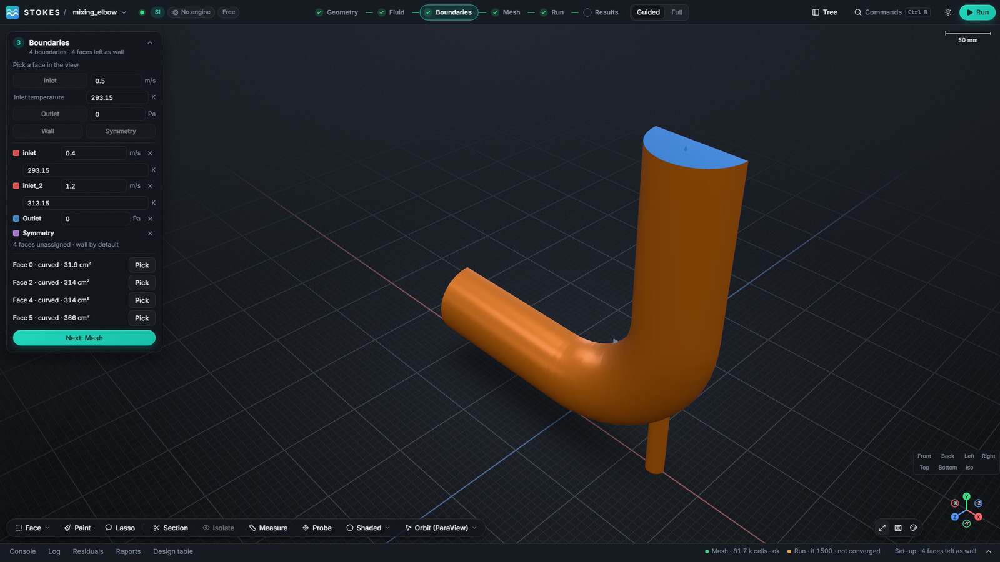 **2. Boundaries.** Click a face, make it an inlet, outlet, wall or symmetry plane, and type the value with its unit. |
| 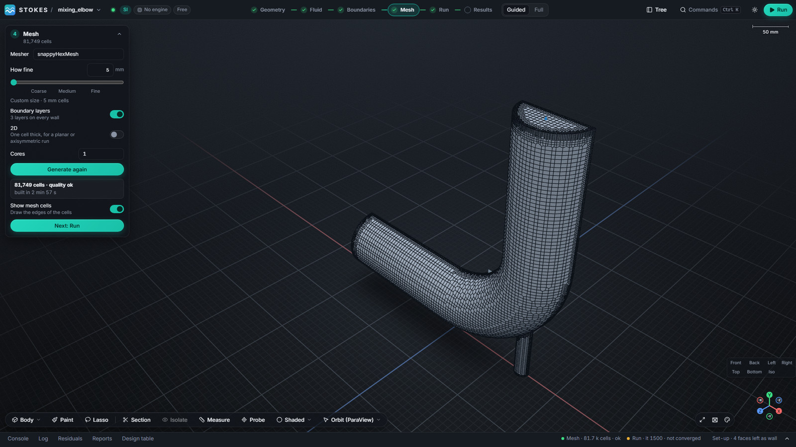 **3. Mesh, fine.** 5 mm cells with three boundary layers: 81,749 cells. | 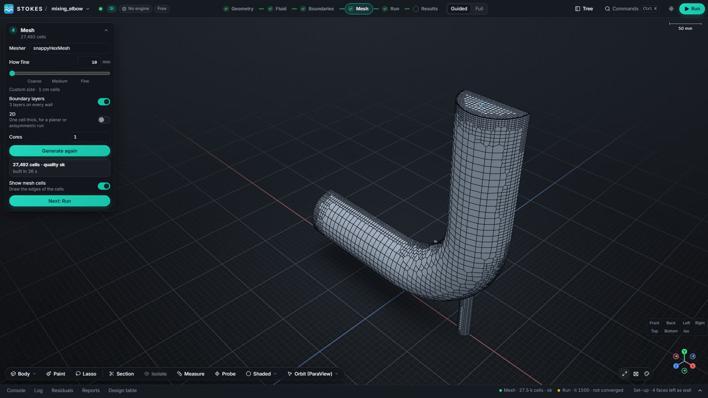 **4. Mesh, coarse.** The same part at 10 mm: 27,492 cells, built in 38 s. |
| 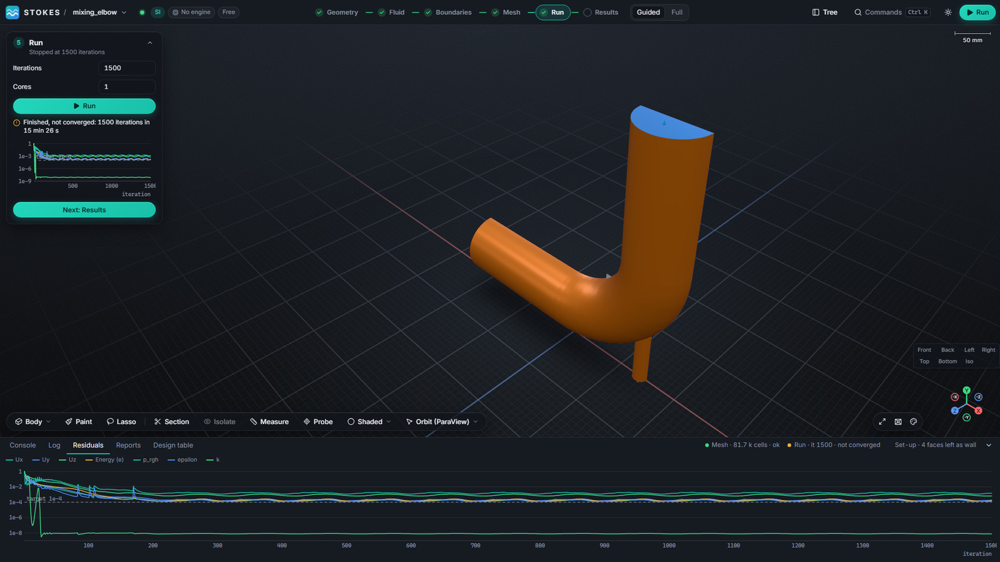 **5. Run.** Live residuals; the run is honestly labelled *not converged* when it is. | 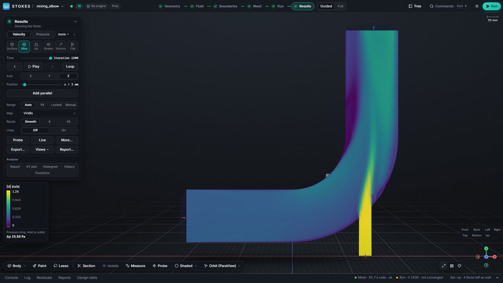 **6. Velocity** on a slice through the symmetry plane: the hot jet entering the bend. |
| 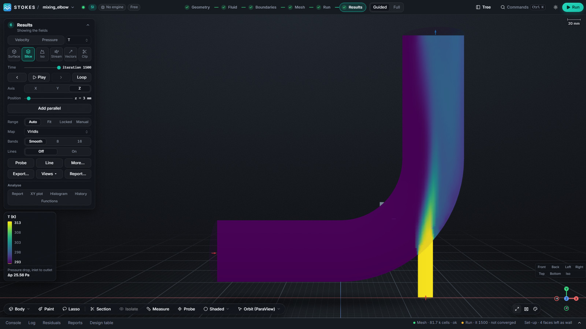 **7. Temperature** on the same slice: the hot streak survives to the outlet on the outer wall. |  **8. Streamlines** traced through the volume from every inlet, coloured by speed. |

### Looks and themes

Three style families, each in dark and light, switch from the **Appearance**
button at the bottom right of the view (or the sun and moon button in the top
bar). Stokes, Cupertino and Ubuntu are shown here; the layout presets and the
theme editor sit in the same popover.

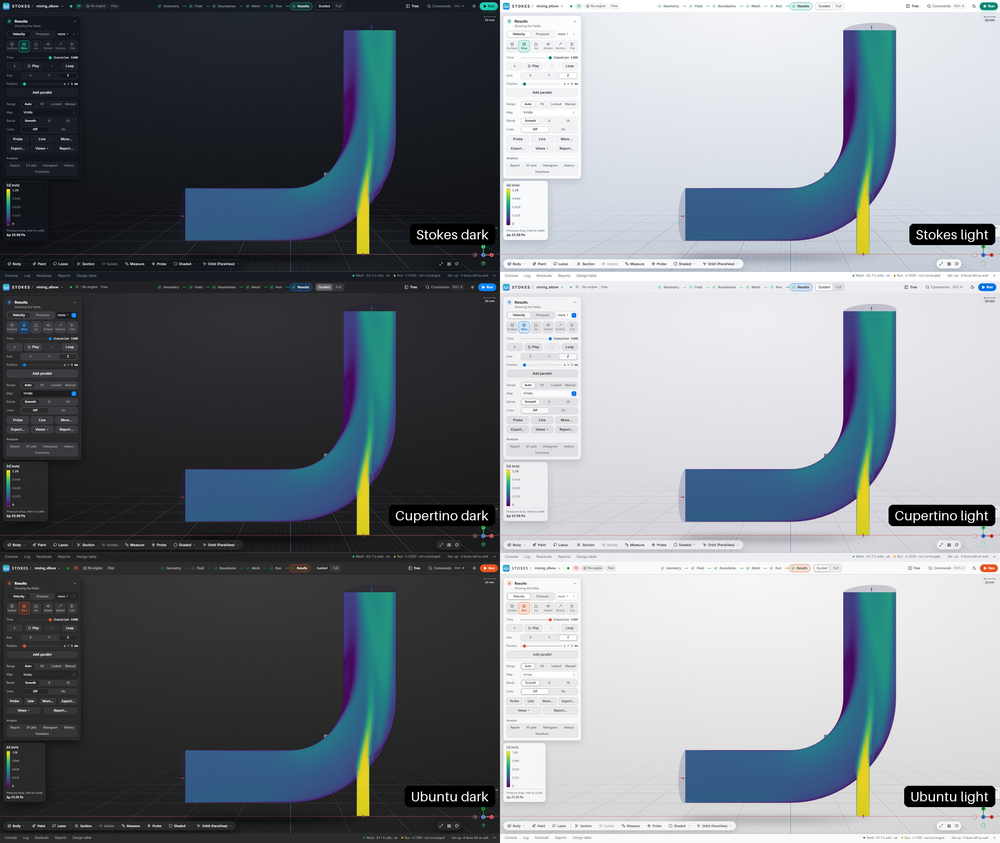

Nine colour maps, chosen on the **Map** control of the Results card, here on the
temperature slice:

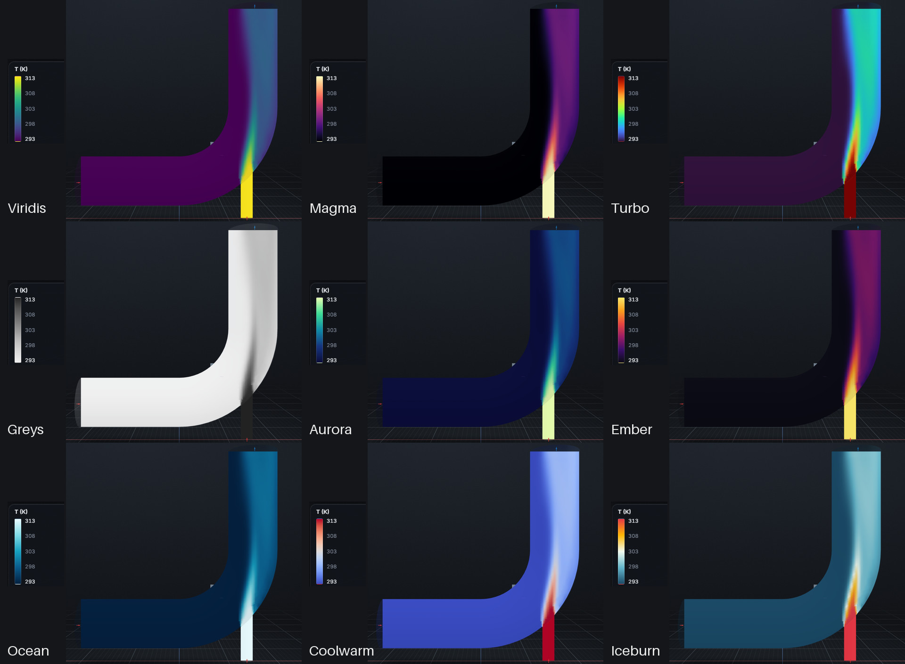

*Full* mode puts the whole simulation tree beside the view:

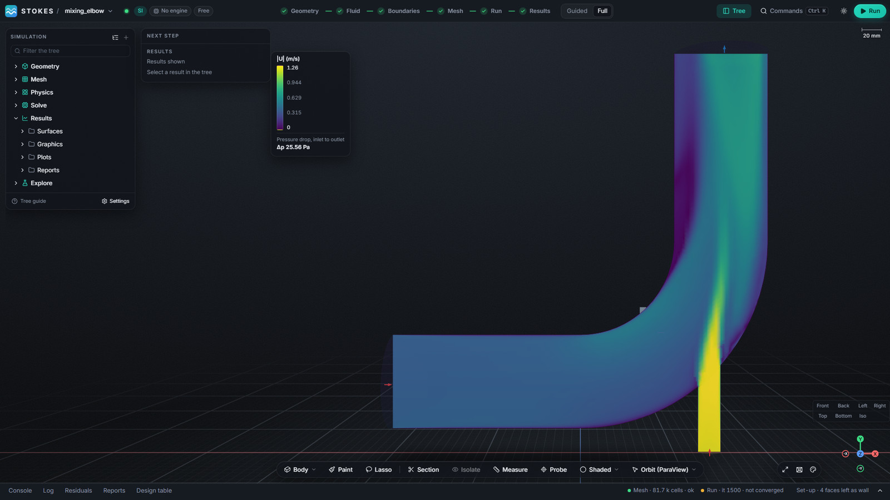

The run shown stopped at 1,500 iterations with residuals just above its
1e-4 target, so treat it as a demonstration of the workflow, not as a validated
prediction.

## What you get

- **A guided path and a full tree.** *Guided* mode walks Geometry → Fluid →
  Boundaries → Mesh → Run → Results. *Full* mode is a Fluent-style tree with
  every setting. Both edit the same model.
- **CAD to mesh.** STEP import (Open CASCADE), face picking and tagging,
  snappyHexMesh, cfMesh (tet, polyhedral, hex-dominant) and blockMesh, with 2D
  and axisymmetric modes.
- **Real solvers.** OpenFOAM Foundation 14: laminar and RANS (k-ε, k-ω SST),
  energy equation, parallel runs over MPI, stop and resume.
- **Results you can use.** Slices, iso-surfaces, clips, streamlines, vectors,
  probes, line plots, a field calculator, reports and exports.
- **Quantities everywhere.** Every number carries a unit; type `2 [m/s]` or
  `U_in * 1.5`.
- **Agent-ready.** One Python API sits behind the window, the `stokes` command
  and a JSON-RPC/WebSocket server (an MCP server is planned). Anything you can
  click, an agent can call.

## Why Stokes

- **No dictionary editing to get started.** The case files are generated from
  the model you build in the window. Existing OpenFOAM cases and tutorials can
  also be imported and their files edited as text inside the app.
- **Native Windows.** It drives a native Windows build of OpenFOAM 14, so there
  is no WSL, virtual machine or Docker layer to set up.
- **Honest results.** A run that stops at its iteration limit is labelled *not
  converged*, with the residual history beside it.
- **Scriptable from the start.** The window, the `stokes` command line and a
  local JSON-RPC server all call the same Python API, so anything you can click
  can be scripted or driven by an agent.
- **Your OpenFOAM, untouched.** Stokes never links or bundles OpenFOAM; it runs
  your installed tools as separate processes.

## What is supported today

| | Status |
|---|---|
| OpenFOAM version | Foundation **14** only. openfoam.com (ESI) versions are not supported yet. |
| Windows 10/11 x64 | Supported, most tested; OpenFOAM through FoamWin, parallel runs through MS-MPI. |
| Linux x86-64 | Supported; one full end-to-end run recorded so far ([details](docs/LINUX-READINESS.md)). |
| macOS | Not supported. |
| Geometry import | STEP (also IGES and BREP from the command line). |
| Meshers | snappyHexMesh, blockMesh, cfMesh (hex-dominant, tetrahedral, polyhedral) and poly-hexcore; 2D planar and axisymmetric modes. |
| Physics | Incompressible and heat-transfer flows: laminar, k-ε, k-ω SST, energy equation. |
| Post-processing | Slices, iso-surfaces, clips, streamlines, vectors, probes, line plots, reports, picture export. |
| Installer | None yet: run from source. |

## Install and run

Stokes runs from source today. There is **no installer yet** (see
[Status](#status)).

| | Windows 10/11 (x64) | Linux (x86-64, Ubuntu 22.04+) |
|---|---|---|
| Guide | **[docs/INSTALL-WINDOWS.md](docs/INSTALL-WINDOWS.md)** | **[docs/INSTALL-LINUX.md](docs/INSTALL-LINUX.md)** |
| Branch | `windows` | `linux` |
| OpenFOAM | [FoamWin](https://github.com/dhanninacs/foamWin/releases/latest) (OpenFOAM 14 and cfMesh for native Windows) | OpenFOAM Foundation 14 from the [official repository](https://openfoam.org/download/) |
| MPI (parallel runs) | Microsoft MPI | OpenMPI (installed with OpenFOAM) |
| Python | 3.13 or 3.14 | 3.13 or 3.14 |
| Node.js (to build the front end) | 22.12 or newer | 22.12 or newer |

The short version, on either platform:

```bash
git clone -b windows https://github.com/dhanninacs/stokes-cfd.git   # or -b linux
cd stokes-cfd
python -m venv .venv                       # Windows: .venv\Scripts\python, Linux: .venv/bin/python
.venv/bin/pip install -e ".[agent,server,ui,cad,extract,explore,materials]"
cd web && npm install && npm run build && cd ..
.venv/bin/python -m stokes.app             # the desktop window
```

Then point Stokes at your OpenFOAM and open a project. The guides give the exact
commands, the engine setup and the fixes for the usual snags.

**Using it:** [docs/USAGE.md](docs/USAGE.md) walks the elbow case above step by
step, then covers the viewport, the results tools, the command line and the
server.

## FAQ

**Is Stokes a GUI for OpenFOAM?**
Yes. It is a desktop pre- and post-processor that sets up, runs and shows
OpenFOAM Foundation 14 cases. It does not replace OpenFOAM; you install OpenFOAM
separately.

**Does it need WSL on Windows?**
No. It runs natively on Windows 10 and 11 against FoamWin, a native Windows build
of OpenFOAM 14. Parallel runs use Microsoft MPI.

**Which OpenFOAM version does it support?**
OpenFOAM Foundation 14 (openfoam.org). The openfoam.com (ESI) line is not
supported yet.

**Does it work on Linux?**
Yes, with the official OpenFOAM 14 packages on Ubuntu 22.04 or newer. Linux has
had less testing than Windows so far.

**Is it free?**
The source is free to use, study and modify for noncommercial purposes under the
PolyForm Noncommercial licence. Commercial use needs a separate licence from the
author.

**Is it open source?**
It is source-available rather than OSI open source: the code is public, but the
licence does not allow commercial use.

**Can I import CAD?**
Yes: STEP files in the window; STEP, IGES and BREP from the command line.

**Which meshers can I use?**
snappyHexMesh and blockMesh, plus cfMesh's hex-dominant, tetrahedral and
polyhedral meshers and a poly-hexcore option. cfMesh is included in FoamWin; on
Linux you build it once ([how](docs/INSTALL-LINUX.md)).

**Can I use it on a remote machine?**
Yes. Run `python -m stokes.server` on the machine and open its URL through an SSH
tunnel. The server only listens on `127.0.0.1` and needs a one-time token.

**Can I script it or drive it from an LLM?**
Yes. Every action in the window is an API command, available from the `stokes`
command line and the local JSON-RPC/WebSocket server.

**Is it endorsed by OpenCFD or the OpenFOAM Foundation?**
No. See the trade-mark notice below.

## Status

Stokes is **pre-alpha** (`0.0.1.dev0`). It works end to end on both platforms and
its gates are green, but:

- There is no installer or signed build yet; you run it from a checkout.
- The first release number, the trade-mark search for the name and the
  Windows signing certificate are the owner's open items.
- FoamWin, the Windows OpenFOAM build, is not yet release-verified.
- The result of a run is only as good as the settings and the mesh. The
  pictures come from a run that stopped "not converged" at its 1e-4 target; the
  run in the video converged in 161 iterations at the default 1e-3 target.

What was run, what passed and what is open is recorded, dated, in
[docs/PRODUCTION-READINESS.md](docs/PRODUCTION-READINESS.md) and
[docs/LINUX-READINESS.md](docs/LINUX-READINESS.md). The plan is in
[docs/06-roadmap.md](docs/06-roadmap.md) and the backlog in
[docs/TASKLIST.md](docs/TASKLIST.md).

## Documentation

| Document | What it answers |
|---|---|
| [docs/INSTALL-WINDOWS.md](docs/INSTALL-WINDOWS.md) | Requirements, FoamWin, install, run, troubleshooting on Windows. |
| [docs/INSTALL-LINUX.md](docs/INSTALL-LINUX.md) | The same for Linux, including OpenFOAM 14 and cfMesh. |
| [docs/USAGE.md](docs/USAGE.md) | A guided tour of the elbow case, the viewport, results, CLI and server. |
| [Guides](https://dhanninacs.github.io/stokes-cfd/) | Task pages: OpenFOAM 14 on Windows without WSL, meshing a STEP file, residual targets and convergence. |
| [llms.txt](llms.txt) | A plain-text summary for LLMs and search tools. |
| [docs/00-open-questions.md](docs/00-open-questions.md) | Every product decision, with its consequence. |
| [docs/01-vision-and-scope.md](docs/01-vision-and-scope.md) | Who it is for, scope, free versus paid. |
| [docs/02-architecture.md](docs/02-architecture.md) | Process model, packages, API surfaces, data model. |
| [docs/03-ui-design.md](docs/03-ui-design.md) | The shell, the stages and the design tokens. |
| [docs/04-licensing-and-dependencies.md](docs/04-licensing-and-dependencies.md) | Dependency audit, the GPL boundary, licence design. |
| [docs/05-openfoam-integration.md](docs/05-openfoam-integration.md) | Case compiler, engine attachment, runners, job states. |
| [docs/06-roadmap.md](docs/06-roadmap.md) | Milestones M0 to M10. |
| `docs/adr/` | One architecture decision record per decision. |
| [CLAUDE.md](CLAUDE.md) | The rules every contributor and agent follows. |
| [CHANGELOG.md](CHANGELOG.md) | What changed, release by release. |

## How it fits together

- **OpenFOAM is attached, never shipped or linked.** Stokes finds your install,
  probes it and drives it as separate processes through files and argv. No GPL
  code is imported, vendored or linked ([ADR-0001](docs/adr/ADR-0001-gpl-process-boundary.md)).
- **One API.** The window, the CLI and the server are all clients of
  `stokes.api`. The front end holds no model state
  ([ADR-0013](docs/adr/ADR-0013-web-front-end.md)).
- **The case is an output.** OpenFOAM dictionaries are generated from the model
  by pure functions; hand edits are recorded overrides.
- **Pure Python with C++ only where measured**, on Python 3.13+. The window is
  a Chromium (QtWebEngine) host on a React and three.js front end.

## Trade marks

OPENFOAM® is a registered trade mark of OpenCFD Limited, producer and distributor
of the OpenFOAM software via www.openfoam.com. This product is not approved or
endorsed by OpenCFD Limited, the OpenFOAM Foundation or The OpenFOAM Foundation
Ltd.

## Contributing and security

Read [CONTRIBUTING.md](CONTRIBUTING.md) and [CLAUDE.md](CLAUDE.md) first. For a
security problem follow [SECURITY.md](SECURITY.md) and do not open a public
issue.

## Licence

Stokes is released under the
[PolyForm Noncommercial License 1.0.0](LICENSE): free to use, study and modify
for noncommercial purposes. Third-party components keep their own licences, listed
in [THIRD-PARTY-NOTICES.md](THIRD-PARTY-NOTICES.md). For commercial use, contact
the author through [GitHub](https://github.com/dhanninacs).

## Support Stokes

Stokes is free for noncommercial use and stays that way thanks to the people who
chip in.

[](https://buymeacoffee.com/csdhan)

**<https://buymeacoffee.com/csdhan>**
