# Using Stokes

A tour of the app, built around one case: a **two-inlet mixing elbow**. Cold water
enters one end of a bend at 0.4 m/s and 293 K, hot water joins through a small
side inlet at 1.2 m/s and 313 K, and the mixture leaves at the other end. The
model is a half elbow with a symmetry plane. You need a STEP file of your own
geometry to follow along; any pipe or duct with a couple of inlets and an outlet
will do.

Install first: [Windows](INSTALL-WINDOWS.md) or [Linux](INSTALL-LINUX.md).
To see the whole case first, watch the
[walkthrough video](video/elbow-walkthrough.webm) (about 1½ minutes, no sound).

Contents: [Start](#start) · [The six steps](#the-six-steps) ·
[Themes and colour maps](#themes-and-colour-maps) ·
[Moving around the 3D view](#moving-around-the-3d-view) ·
[Results tools](#results-tools) · [Full mode](#full-mode-and-the-tree) ·
[Command line](#command-line) · [Server and agents](#server-and-agents) ·
[Tips](#tips-and-gotchas)

## Start

Run `python -m stokes.app`. The start screen offers **New project**, **Open**,
recent projects, **Examples** (a sample project is copied and opened) and
**Tutorials**. Choose **New project**, give it a name (spaces are fine) and the
top bar appears:

```
Geometry — Fluid — Boundaries — Mesh — Run — Results        Guided | Full
```

Each step is a card on the left and a view in the middle. A tick means the step
is done. You can jump to any step; **Next** at the bottom of a card moves on.
**Guided** shows the essentials; **Full** shows everything (see
[below](#full-mode-and-the-tree)). Both edit the same project, and every edit can
be undone with `Ctrl+Z` (redo with `Ctrl+Y`).

The command palette (`Ctrl+K`, or **Commands** in the top bar) finds every action
by name.

## The six steps

### 1. Geometry

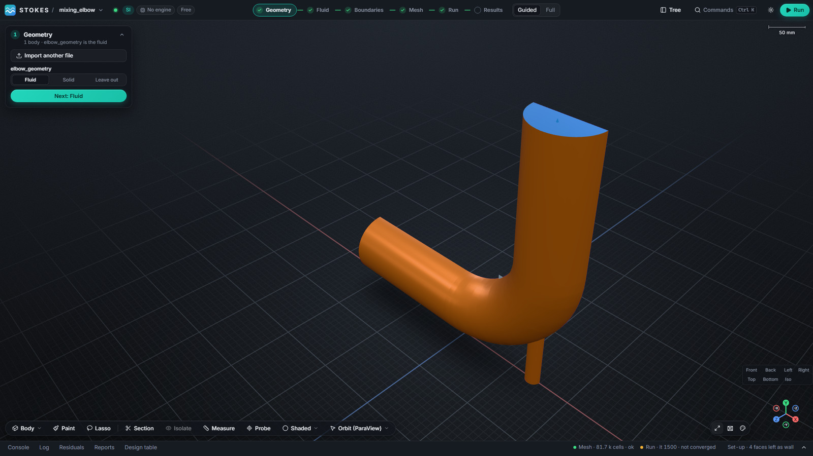

**Import** a STEP file (`.stp` or `.step`). The part appears in the view, with
small markers where faces were found. Tell Stokes what each body is: **Fluid**
(the volume to solve), **Solid** (a conducting solid) or **Leave out**. For an
internal flow like this one, the part is the fluid. Large assemblies import in a
background process, so the window stays usable.

### 2. Fluid

Pick the **material**: **Water** or **Air**, or **Browse the library…** for
others (properties come from the built-in catalogue, CoolProp and Cantera). Then
the physics:

- **Flow:** Laminar, Turbulent k-ε or Turbulent k-ω SST.
- **Heat transfer:** Off, or On to solve the energy equation. With it on, inlets
  also take a temperature.

For the elbow: water, Turbulent k-ε, heat transfer On.

### 3. Boundaries

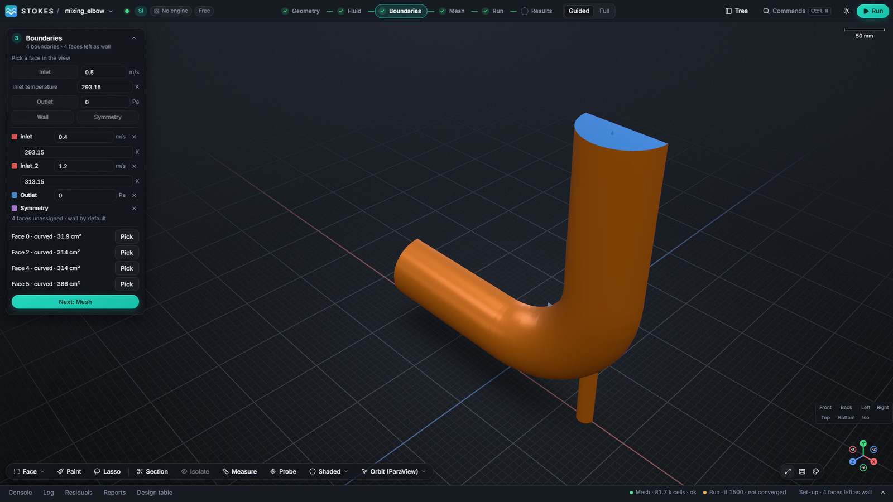

Every face that is not told otherwise is a **wall**. Click a face in the view, or
press **Pick** beside it in the list, then choose what it is:

| Kind | You enter |
|---|---|
| **Inlet** | speed in m/s (and temperature in K when heat transfer is on) |
| **Outlet** | pressure in Pa (gauge) |
| **Wall** | nothing (no-slip) |
| **Symmetry** | nothing; use it for a plane you have cut the model along |

Assign a second inlet the same way; it is listed as *Inlet · inlet_2*. Values
take units and expressions: `0.4`, `0.4 [m/s]` or `U_in * 1.5`. The list on the
card describes each unassigned face (size and shape) so you can tell which is
which.

### 4. Mesh

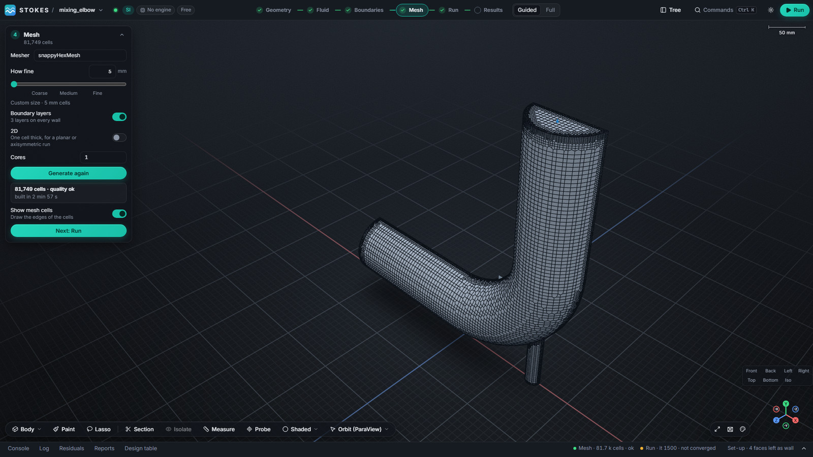

**How fine** is a slider with Coarse, Medium and Fine marked on it, and a box
where you can type a cell size such as `5 mm` or `1 cm`. **Boundary layers** adds
thin cells along the walls, which matter for heat transfer and wall shear.
Press **Generate**. The card reports the cell count, whether the mesh passed its
quality checks, and how long it took. **Show mesh cells** draws the cell edges.

The same part, coarser, builds faster and is the right first try:

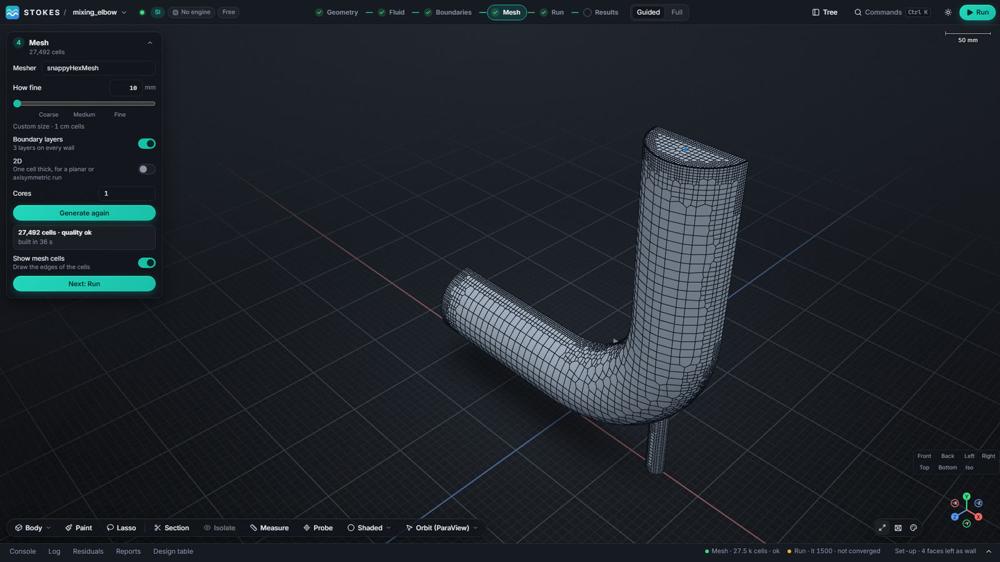

| Setting | Cells | Built in |
|---|---|---|
| 5 mm with three boundary layers | 81,749 | about 3 minutes |
| 10 mm | 27,492 | 38 seconds |

Times are from one Windows machine; yours will differ. The default mesher is
snappyHexMesh. In **Full** mode you can also choose cfMesh (tetrahedral,
polyhedral, hex-dominant) or blockMesh, set cores for the mesher, and keep
several meshes and pick which one the run uses.

### 5. Run

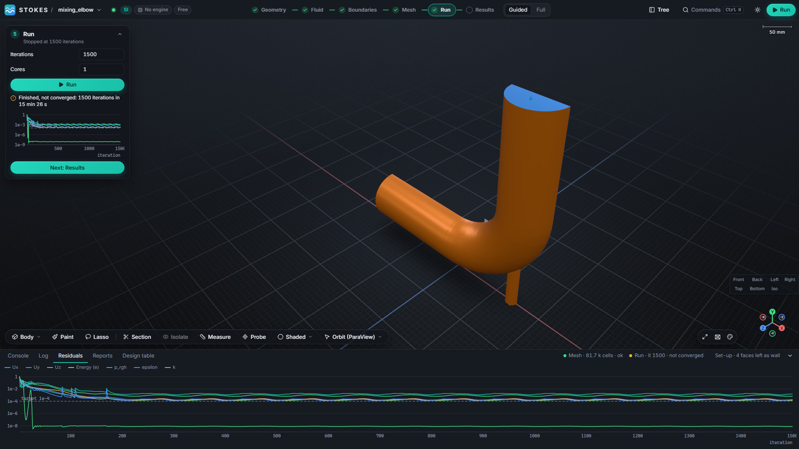

Set **Iterations** and **Cores**, then press **Run** (the same button is in the
top bar). Stokes writes the OpenFOAM case, runs the solver and streams the
residuals into the chart; the **Residuals** tab of the bottom drawer shows the
full history and the **Log** tab shows the solver output. **Stop** ends a run and
keeps what it has; you can resume it.

When the run finishes it is labelled honestly:

- **Converged**: every residual reached its target.
- **Not converged**: it stopped at the iteration limit. The elbow above stopped at
  1,500 iterations with residuals just above 1e-4. Its fields are usable to see
  the flow, but run longer or tighten the settings before relying on numbers.

More than one core needs MPI (MS-MPI on Windows, OpenMPI on Linux); the guide for
your platform says how.

### 6. Results

Velocity on a slice through the symmetry plane: the fast hot jet from the small
inlet is bent along the outer wall, a slow wake sits inside the bend.

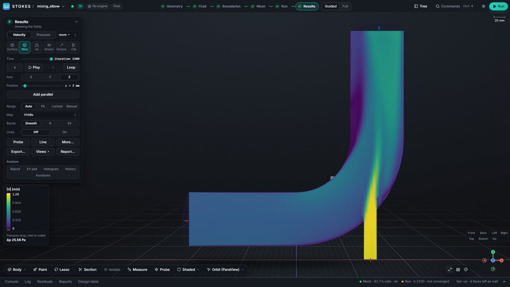

Temperature on the same slice: the hot streak is still visible at the outlet.

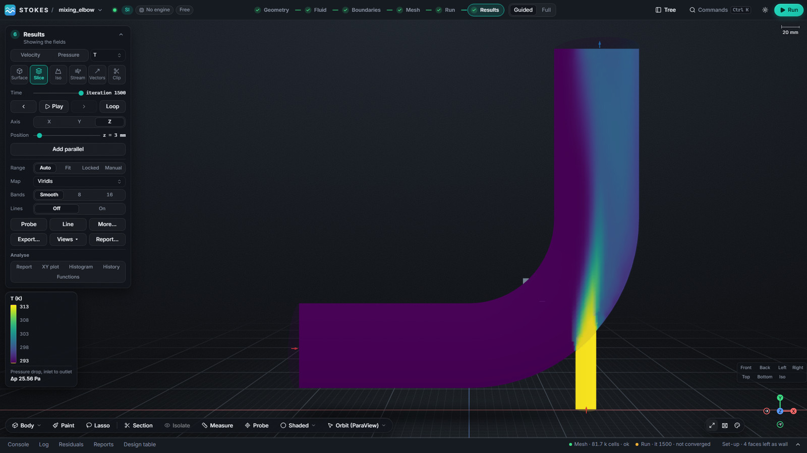

Streamlines from both inlets, traced through the volume and coloured by speed:

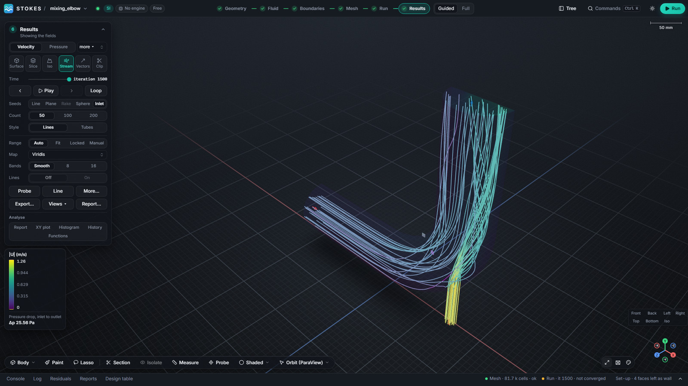

## Themes and colour maps

The **Appearance** button at the bottom right of the view opens the look
settings: **Style** (Stokes, Cupertino or Ubuntu), **Appearance** (Dark, Light or
Auto, which follows your system) and the **Layout** presets (Stokes, Classic,
Ribbon, Workflow, Minimal). **Customise…** rearranges the panels and **Theme
editor…** changes the colours. The sun or moon button in the top bar toggles dark
and light.

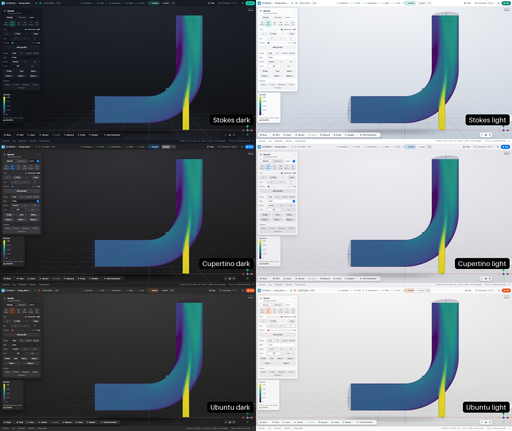

On the Results card, **Map** sets the colour map for the legend and every look:
Viridis (the default), Magma, Turbo, Greys, Aurora, Ember, Ocean, Coolwarm and
Iceburn. A perceptual map such as Viridis or Magma reads best for most fields;
Coolwarm and Iceburn suit values that pass through a midpoint; Greys prints well.

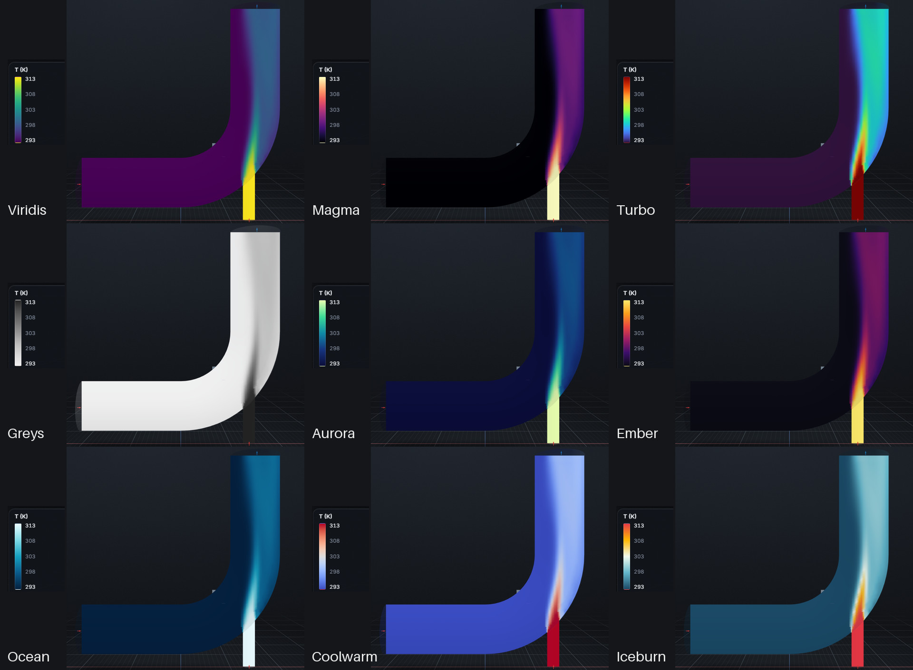

## Moving around the 3D view

| Do | Result |
|---|---|
| Left-drag | orbit |
| Right-drag or middle-drag | pan |
| Scroll | zoom |
| Click | select a face or body |
| Shift-drag | box select |
| **Fit to view** (bottom right) | frame the whole model |
| Orthographic button | switch between perspective and orthographic |

The toolbar at the bottom of the view has the pick mode (Body, Face), **Paint**
and **Lasso** selection, **Section** (cut the model with a plane and drag it),
**Isolate**, **Measure** (distances between points, edges and faces), **Probe**,
the display mode (Shaded, wireframe, edges) and the **mouse scheme** menu, which
also offers CAD, Blender and Select/Orbit styles. The moon or sun button in the
top bar switches the appearance; the choice is remembered.

## Results tools

The Results card has a field row at the top (**Velocity**, **Pressure**, and
**more** for temperature, the velocity components and anything else the run
wrote), and a row of ways to draw it:

| Look | What it does |
|---|---|
| **Surface** | colours the walls by the field |
| **Slice** | a plane through the volume; choose the axis and drag the position, or **Add parallel** for more planes |
| **Iso** | a surface of constant value, for example T = 300 K |
| **Stream** | streamlines from the inlets, a line, a plane, a sphere or a rake; lines or tubes; 50, 100 or 200 of them |
| **Vectors** | arrows sampled through the volume or on a slice; set the density and scale |
| **Clip** | removes one side of the model along a plane to show the interior |

Below them: **Range** (Auto, Locked or Manual), the colour **Map**, and **Bands**
(Smooth, 8 or 16). Double-click either end of the colour bar to type a range;
double-click the legend title for a print-size legend. The legend also shows the
inlet-to-outlet pressure drop.

The buttons at the bottom of the card: **Probe** reads a value at a point,
**Line** plots the field along a line, **More…** opens the rest of the Results
panel, **Export…** saves a picture of the view, **Views** saves and recalls named
views (camera, field, range, colour map and look) and can export one picture per
view, and **Report…** builds a report from a finished run.

## Full mode and the tree

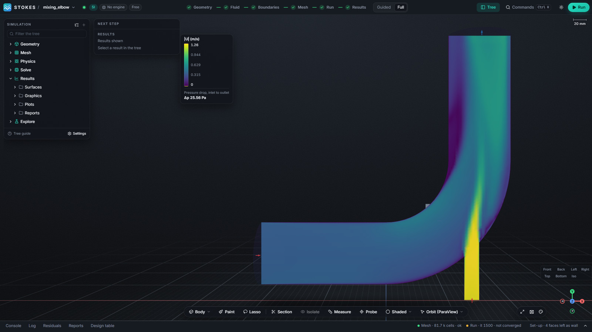

Switch **Guided** to **Full** at the top, or open **Tree**. The tree follows the
usual workbench layout: Geometry, Mesh, Physics (materials, regions, boundary
conditions), Solve, Results and Explore. Select a node to edit it in
**Properties**. Full mode adds, among other things:

- every solver setting (schemes, tolerances, relaxation, transient controls),
  with search, explanations and an essentials-only view;
- turbulence and wall treatment choices, gravity and operating pressure;
- named parameters, so a speed can be `U_in` in several places;
- the **Explore** stage: design tables and studies that vary parameters and
  collect the results;
- importing an existing OpenFOAM case or tutorial and editing its files as text;
  files are checked before they are staged, and code directives are refused.

## Command line

Everything the window does is an API command, and the `stokes` command runs them
without a display:

```bash
stokes new demo --name demo                          # a new project
stokes param demo U_in velocity "2 [m/s]"            # a named parameter with a unit
stokes set demo /physics/parameters/U_in value "U_in * 1.5"
stokes tree demo                                     # print the model tree
stokes geometry import demo part.step                # import a STEP file
stokes --help                                        # every command
```

Output is JSON where it makes sense, so scripts can read it. Each command is
recorded in the project's journal and can be replayed.

## Server and agents

```bash
python -m stokes.server --port 8740
```

starts the local server and prints a URL such as
`http://127.0.0.1:8740/?token=…`. Open it in a browser for the same interface as
the window, or connect to its WebSocket JSON-RPC endpoint to call the API from
code or from an LLM agent. The server binds to `127.0.0.1` and requires the
token. The command set and its schemas are generated from the model; see
[02-architecture.md](02-architecture.md) and
[ADR-0010](adr/ADR-0010-api-first-and-agents.md).

## Tips and gotchas

- **Start coarse.** Mesh at 10 mm first, check the setup and the result, then
  refine. A converged coarse answer beats an unconverged fine one.
- **Check the mesh card** before running. "Quality ok" means the mesh passed
  OpenFOAM's `checkMesh`; warnings tell you what is left.
- **Read the residuals.** A flat line above the target is not converged, whatever
  the colours look like.
- **Symmetry planes** should be flat and lie on the part's bounding plane;
  Stokes anchors the background grid so they mesh flat.
- **Save often.** Work is autosaved to a recovery copy and offered back after a
  crash, but save the project when a step is done.
- **Paths.** Keep projects in short paths on a local disk.
- **Slow on a laptop?** Use fewer cells, more cores, and turn **Show mesh cells**
  off while orbiting.

Something unclear or broken? Open an issue on GitHub. If Stokes helps your work,
you can [buy me a coffee](https://buymeacoffee.com/csdhan).
