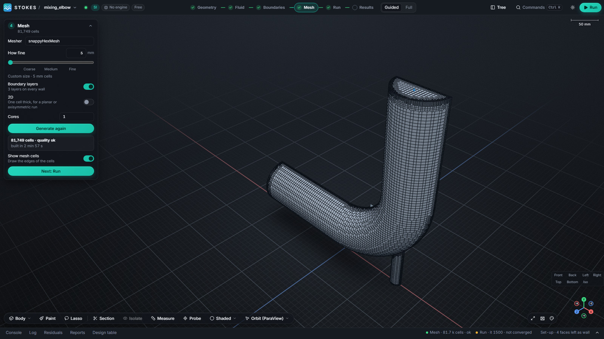

This page shows how to get from a STEP file to a checked OpenFOAM 14 mesh in
[Stokes](https://github.com/dhanninacs/stokes-cfd), without writing
`snappyHexMeshDict` or `meshDict` by hand.

## 1. Import the geometry

In a new project, open **Geometry** and import a `.stp` or `.step` file (the
command line also takes IGES and BREP: `stokes geometry import`). For an internal
flow, mark the body as **Fluid**. Large assemblies import in a background
process, so the window stays usable.

## 2. Tag the boundaries

Open **Boundaries**. Every face starts as a wall. Pick a face, in the view or
with **Pick** beside it in the list, then choose **Inlet**, **Outlet**, **Wall**
or **Symmetry** and type the value with its unit, for example `0.4 [m/s]`. The
boundary names become the mesh patch names, so the solver settings line up with
them automatically.

## 3. Choose a mesher and a cell size

Open **Mesh** and pick the **Mesher**:

| Mesher | Cells | Good for |
|---|---|---|
| snappyHexMesh | hex-dominant, cut to the shape | the default; follows the part's own surfaces and supports boundary layers |
| Hex-dominant (cfMesh cartesianMesh) | Cartesian hex core, polyhedra at the wall | few cells, very good quality |
| Tetrahedral (cfMesh tetMesh) | tetrahedra | any shape, but about ten times the cells for the same size |
| Polyhedral (cfMesh pMesh) | polyhedra | fewer cells than tetrahedra, well-behaved gradients |
| Poly-hexcore (cartesianMesh + polyDualMesh) | hexahedra in the core, polyhedra at transitions and walls | a balance of cell count and quality |
| blockMesh | structured blocks | simple boxes and channels |

Set **How fine** with the slider (Coarse, Medium, Fine) or type a cell size such
as `10 mm`. Turn on **Boundary layers** for heat transfer and wall shear. **2D**
makes a one-cell-thick planar or axisymmetric mesh. **Cores** runs the mesher in
parallel where it can (MPI for snappyHexMesh, OpenMP threads for cfMesh).

Start coarse. On the mixing elbow in the screenshots, 10 mm cells gave 27,492
cells in under a minute; 5 mm with three boundary layers gave 81,749 cells in
about three minutes.

## 4. Generate and check

Press **Generate**. The card names each step while it runs and then reports the
cell count and whether the mesh passed `checkMesh`. **Show mesh cells** draws the
cell edges. Stokes keeps one result per mesher, so you can compare a
snappyHexMesh and a cfMesh mesh of the same part and choose which one the run
uses.

## Notes on cfMesh

- **Windows:** FoamWin v14.0.0-win.5 and newer include cfMesh.
- **Linux:** do not use cfMesh 1.2.0 with OpenFOAM 14; build the Foundation-13
  port as described in the
  [Linux install guide](https://github.com/dhanninacs/stokes-cfd/blob/main/docs/INSTALL-LINUX.md).
- Tetrahedral and hex-dominant cfMesh meshes can bend a symmetry plane where a
  wall meets it. Stokes flattens it as far as the cells allow and reports what is
  left on the Mesh card. Polyhedral and snappyHexMesh meshes are not affected.

---

OPENFOAM® is a registered trade mark of OpenCFD Limited. Stokes is not approved
or endorsed by OpenCFD Limited or the OpenFOAM Foundation.
