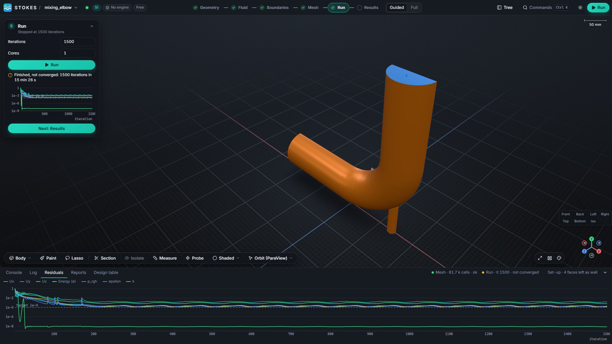

[Stokes](https://github.com/dhanninacs/stokes-cfd) runs steady OpenFOAM 14 cases
until they converge or reach an iteration limit, and it labels the result
honestly. This page explains the two settings involved and how to read the
residuals.

## The two settings

- **Residual target.** A run stops as soon as the *initial* residual of every
  solved field (velocity components, pressure, energy, turbulence quantities)
  falls below the target. The default for a new project is **1e-3**. You can
  change it in the solver settings in Full mode.
- **Iterations.** The maximum number of iterations, set on the **Run** card.
  The run stops there even if the residuals are still above the target.

## Converged or not converged

When a run ends, the Run card and the status bar say which happened:

- **Converged**: every residual reached the target.
- **Not converged**: the run reached its iteration limit first. This is not a
  failure. The fields are written and you can look at them, but treat numbers
  from them with care until you have checked the quantities you care about.
- **Failed**: the solver stopped with an error. The **Log** tab in the bottom
  drawer shows the solver output.

Examples from the mixing elbow in the screenshots: one run converged in 161
iterations at the default 1e-3 target; another, with a tighter 1e-4 target,
stopped at 1,500 iterations as *not converged*, with residuals oscillating just
above the target.

## Reading the residual chart

The Run card shows a small chart while the solver runs; the **Residuals** tab in
the bottom drawer shows the full history with one line per field and the target
drawn as a dashed line. Look for:

- **A steady fall** to the target: the run is converging.
- **A flat line or a slow ripple above the target**: the solution has settled as
  far as these settings allow. Check whether the quantities you care about (an
  outlet temperature, a pressure drop) still change. If they do not, the result
  may be usable; if they do, refine the mesh, change the schemes or run a
  transient case.
- **A sudden rise or very large values**: the run is diverging. Look at the mesh
  quality warnings on the Mesh card and at the boundary values.

## Tips

- A tighter target is not always better: on a coarse mesh the residuals can level
  off above 1e-4. Decide what accuracy you need and check a monitored quantity.
- Start with a coarse mesh to check the set-up, then refine.
- Stop a long run with **Stop**; it keeps what it has, and you can resume it.

---

OPENFOAM® is a registered trade mark of OpenCFD Limited. Stokes is not approved
or endorsed by OpenCFD Limited or the OpenFOAM Foundation.
