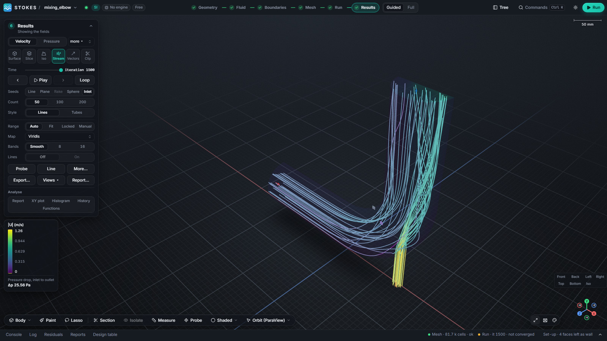

Stokes is a desktop CFD workbench and graphical interface for OpenFOAM®
Foundation 14. You import a STEP file, click faces to make them inlets, outlets,
walls or symmetry planes, mesh with snappyHexMesh or cfMesh, run the solver and
look at slices, streamlines and iso-surfaces, in one window. Every action is also
an API command, so scripts and LLM agents can drive a simulation too.

It runs natively on **Windows** (through [FoamWin](https://github.com/dhanninacs/foamWin),
a native Windows build of OpenFOAM 14, no WSL needed) and on **Linux** (the
official OpenFOAM 14 packages). It is pre-alpha, runs from source, and is free
for noncommercial use.

**Source and releases:** <https://github.com/dhanninacs/stokes-cfd> ·
**Walkthrough video (90 s):** [elbow-walkthrough.webm](https://github.com/dhanninacs/stokes-cfd/releases/download/windows-2026-11-09/elbow-walkthrough.webm)

## Guides

- [Run OpenFOAM 14 on Windows without WSL](guides/openfoam-14-on-windows-without-wsl.html):
  install FoamWin, point Stokes at it, and run a case natively.
- [Mesh a STEP file with snappyHexMesh or cfMesh](guides/mesh-a-step-file.html):
  import, tag boundaries, choose a mesher and cell size, check quality.
- [Residual targets and convergence](guides/residual-targets-and-convergence.html):
  what "converged" and "not converged" mean in Stokes and how to read the residuals.

## Install and use

- [Install on Windows](https://github.com/dhanninacs/stokes-cfd/blob/main/docs/INSTALL-WINDOWS.md)
- [Install on Linux](https://github.com/dhanninacs/stokes-cfd/blob/main/docs/INSTALL-LINUX.md)
- [Usage tour: the mixing elbow, step by step](https://github.com/dhanninacs/stokes-cfd/blob/main/docs/USAGE.md)
- [FAQ](https://github.com/dhanninacs/stokes-cfd#faq)

## What is supported today

| | Status |
|---|---|
| OpenFOAM version | Foundation 14 only; openfoam.com (ESI) versions are not supported yet |
| Windows 10/11 x64 | Supported, most tested; FoamWin and MS-MPI |
| Linux x86-64 | Supported; less tested than Windows |
| macOS | Not supported |
| Geometry | STEP in the window; STEP, IGES and BREP from the command line |
| Meshers | snappyHexMesh, blockMesh, cfMesh hex-dominant, tetrahedral and polyhedral, poly-hexcore; 2D modes |
| Physics | Laminar, k-ε, k-ω SST, energy equation |
| Installer | None yet; run from source |

---

OPENFOAM® is a registered trade mark of OpenCFD Limited, producer and distributor
of the OpenFOAM software via www.openfoam.com. Stokes is not approved or endorsed
by OpenCFD Limited or the OpenFOAM Foundation. Stokes is released under the
PolyForm Noncommercial License 1.0.0.
